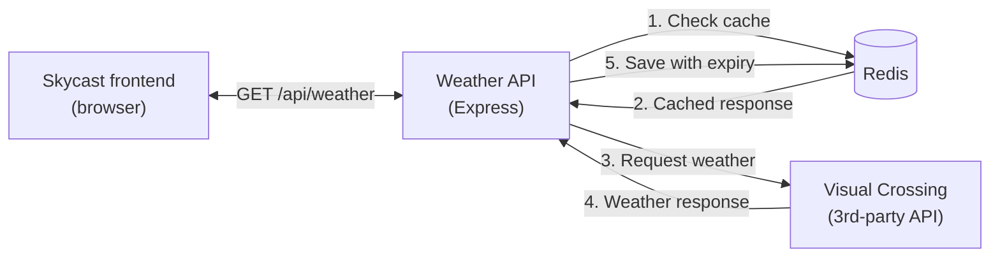
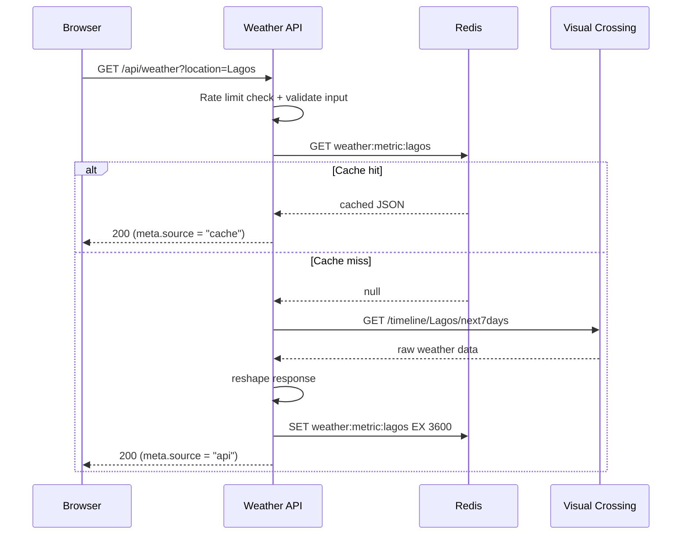

# ⛅ Skycast · Weather API


A fullstack weather application. The **backend** is a weather API that fetches data from a 3rd-party weather service (Visual Crossing), caches it in **Redis**, applies **rate limiting** and returns a clean JSON response. The **frontend**, *Skycast*, is a weather dashboard that uses this API to show current conditions, the next 24 hours and a 7-day forecast for any city in the world.

Built for the [roadmap.sh Weather API project](https://roadmap.sh/projects/weather-api-wrapper-service) as my Week 2 fullstack project.

🔗 **Live site:** https://YOUR-APP-NAME.onrender.com  <!-- TODO: replace after deploying -->

🎬 **Demo video:**

<!-- TODO: on GitHub, edit this file and drag your .mp4 here (max 10 MB), or paste a YouTube/Loom link -->

📸 **Screenshot:**

<!-- TODO: add a screenshot, e.g.  -->

---

## Table of Contents

1. [Overview](#overview)
2. [Features](#features)
3. [Architecture](#architecture)
4. [Tech Stack](#tech-stack)
5. [Project Structure](#project-structure)
6. [Getting Started](#getting-started)
7. [Environment Variables](#environment-variables)
8. [API Reference](#api-reference)
9. [Caching Strategy](#caching-strategy)
10. [Rate Limiting](#rate-limiting)
11. [Error Handling](#error-handling)
12. [Frontend Guide](#frontend-guide)
13. [Testing](#testing)
14. [Deployment](#deployment)
15. [Challenges & How I Overcame Them](#challenges--how-i-overcame-them)
16. [What I Learned](#what-i-learned)
17. [Future Improvements](#future-improvements)
18. [Acknowledgements](#acknowledgements)

---

## Overview

Instead of storing our own weather data, this project builds a **wrapper API** around a 3rd-party weather service. The goal of the project is to practise three things:

- **Working with 3rd-party APIs**: calling an external service, handling its errors and reshaping its responses
- **Caching**: storing results in Redis so repeat requests are fast and don't use up the daily API quota
- **Environment variables**: keeping the API key and settings out of the code

On top of the API, I built a frontend that makes the most of the data: search, geolocation, unit switching, favourites, forecasts and a live view of how the cache behaves.

---

## Features

### Backend (Weather API)

| Feature | Description |
|---|---|
| Weather lookup | Current conditions, next 24 hours and 7-day forecast for any city, address or `lat,lon` |
| Two URL styles | `/api/weather?location=Lagos` and `/api/weather/Lagos` |
| Metric & US units | `unit=metric` (°C, km/h) or `unit=us` (°F, mph) |
| Redis caching | Results cached with an automatic expiry (default 1 hour) |
| Smart cache keys | Trims and lowercases city names, so `Lagos`, ` lagos ` and `LAGOS` share one cache entry |
| Resilient cache | Falls back to an in-memory cache if Redis isn't set up or goes down |
| Rate limiting | 60 requests per IP every 15 minutes, with standard `RateLimit` headers |
| Clear errors | Consistent JSON errors with codes like `LOCATION_NOT_FOUND`, `RATE_LIMITED` and `UPSTREAM_TIMEOUT` |
| Timeouts | Gives up on the weather service after 8 seconds instead of hanging |
| Smaller responses | Keeps only the fields the app needs, so responses are much smaller than the raw data |
| Health check | `/api/health` shows the server status and which cache is active |
| Security | API key only in env vars and never in responses; security headers; input validation |

### Frontend (Skycast dashboard)

| Feature | Description |
|---|---|
| City search | Search any city; press `/` anywhere to jump to the search box |
| Use my location | 📍 button uses browser geolocation to load local weather |
| °C / °F toggle | Switch units instantly; your choice is remembered |
| Current conditions | Temperature, feels like, today's high/low, conditions and a summary |
| Detail cards | Humidity, wind (with a direction arrow), chance of rain, UV index, sunrise/sunset, pressure, visibility, cloud cover |
| Hourly forecast | Scrollable next-24-hours strip with rain chances |
| 7-day forecast | Daily highs and lows with colour bars on a shared temperature scale |
| Favourites ★ | Save cities, which show as one-tap chips; the first favourite loads on start |
| Recent searches | Your last 6 searches as quick chips |
| Cache badge | Shows whether data came from the cache or fresh from the weather service, when it refreshes, and the response time |
| Weather themes | Background changes for clear, night, cloudy, rain, storm, snow and fog |
| API panel | Shows the exact API request and the raw JSON response, with a copy button |
| Shareable links | URLs like `/?q=Lagos&unit=us` open straight to that city |
| Friendly states | Welcome screen, loading skeletons and clear error screens (place not found, offline, rate limited and more) |
| Responsive | Works on phones, tablets and desktops; respects reduced-motion settings |

---

## Architecture



### Request flow



The backend and frontend run on **one server**: Express serves the API under `/api/*` and the frontend files from `frontend/`. That means one deployment, and no CORS setup is needed.

---

## Tech Stack

| Layer | Technology | Why I chose it |
|---|---|---|
| Runtime | **Node.js 22** | Built-in `fetch`, `AbortSignal.timeout` and test runner, so fewer packages are needed |
| Web framework | **Express 5** | Simple and widely used; v5 passes errors from async routes to the error handler automatically |
| Cache | **Redis** (`redis` client v5) | Fast key-value store with built-in key expiry, which suits caching perfectly |
| Rate limiting | **express-rate-limit** | Well-tested middleware that sends standard `RateLimit` headers |
| Config | **dotenv** | Loads environment variables from a `.env` file during development |
| 3rd-party API | **Visual Crossing** | Free tier, one request returns current + hourly + daily data, and accepts city names or coordinates |
| Frontend | **HTML, CSS, vanilla JavaScript** | No build step, fast to load, and it shows the fundamentals clearly |
| Testing | **Node's built-in test runner** | No extra test framework needed |
| Hosting | **Render** | Free web service plus a free Redis-compatible Key Value instance, set up from one `render.yaml` |

---

## Project Structure

```
weather_app/
├── backend/
│   ├── server.js               # Entry point: loads config, connects the cache, starts the server
│   ├── src/
│   │   ├── app.js              # Express app: routes, rate limiter, security headers, error handler
│   │   ├── weatherService.js   # Calls Visual Crossing, uses the cache, reshapes data, maps errors
│   │   ├── cache.js            # RedisCache, MemoryCache and the ResilientCache fallback wrapper
│   │   └── config.js           # Reads and validates environment variables
│   └── test/
│       ├── api.test.js         # 16 end-to-end tests
│       └── fixtures.js         # Sample Visual Crossing response used by the tests
├── frontend/
│   ├── index.html              # Page layout
│   ├── styles.css              # Styles, weather themes and responsive layout
│   └── app.js                  # Search, rendering, favourites, unit toggle, geolocation
├── .env.example                # Template for environment variables
├── .gitignore
├── package.json
├── render.yaml                 # Render deployment config (web service + Redis)
└── README.md
```

---

## Getting Started

### Prerequisites

- [Node.js](https://nodejs.org/) **22 or newer**
- A free **Visual Crossing API key**: sign up at [visualcrossing.com/sign-up](https://www.visualcrossing.com/sign-up) and copy the key from your account page
- *(Optional)* **Redis**. Without it, the app uses its in-memory cache.

### 1. Clone and install

```bash
git clone https://github.com/datalabcons/weather_app.git
cd weather_app
npm install
```

### 2. Set up environment variables

```bash
cp .env.example .env
```

Open `.env` and paste your key:

```env
WEATHER_API_KEY=your-visual-crossing-api-key
```

### 3. (Optional) Start Redis

Choose one:

```bash
# With Docker
docker run -d --name redis -p 6379:6379 redis

# On macOS with Homebrew
brew install redis && brew services start redis
```

Then add this to `.env`:

```env
REDIS_URL=redis://localhost:6379
```

You can also use a free hosted Redis from [Upstash](https://upstash.com/) and paste its `rediss://...` URL.

### 4. Run the app

```bash
npm run dev     # starts with auto-reload at http://localhost:3000
# or
npm start       # normal start
```

The console shows which cache is in use:

```
Connected to Redis.
Weather API running at http://localhost:3000
```

### Available scripts

| Command | What it does |
|---|---|
| `npm start` | Starts the server |
| `npm run dev` | Starts the server and restarts it when files change |
| `npm test` | Runs all tests |

---

## Environment Variables

| Variable | Required | Default | Description |
|---|---|---|---|
| `WEATHER_API_KEY` | **Yes** | – | Your Visual Crossing API key |
| `REDIS_URL` | No | *(empty)* | Redis connection string. If empty, the in-memory cache is used. |
| `PORT` | No | `3000` | Port the server listens on |
| `CACHE_TTL_SECONDS` | No | `3600` | How long a result stays cached, in seconds |
| `RATE_LIMIT_MAX` | No | `60` | Max API requests per IP in each window |
| `RATE_LIMIT_WINDOW_MINUTES` | No | `15` | Length of the rate-limit window, in minutes |
| `UPSTREAM_TIMEOUT_MS` | No | `8000` | How long to wait for Visual Crossing before giving up |

`.env` is listed in `.gitignore`, so your API key is never committed.

---

## API Reference

Base URL: `http://localhost:3000` locally, or your Render URL in production.

### `GET /api/weather`

Returns weather for a location.

**Query parameters**

| Name | Required | Example | Description |
|---|---|---|---|
| `location` | Yes | `Lagos`, `London,UK`, `6.45,3.39` | City, address or `latitude,longitude` (max 100 characters) |
| `unit` | No | `metric` or `us` | Unit system. Defaults to `metric`. |

**Example requests**

```bash
curl "http://localhost:3000/api/weather?location=Lagos"
curl "http://localhost:3000/api/weather?location=New%20York&unit=us"
curl "http://localhost:3000/api/weather?location=6.4550,3.3940"
```

### `GET /api/weather/:location`

Same as above, with the location in the path:

```bash
curl "http://localhost:3000/api/weather/Abuja?unit=metric"
```

### Example response `200 OK`

*(The `hourly` and `daily` lists are shortened here; the API returns 24 hours and 7 days.)*

```json
{
  "location": {
    "query": "Lagos",
    "resolvedAddress": "Lagos, Nigeria",
    "timezone": "Africa/Lagos",
    "latitude": 6.455,
    "longitude": 3.394
  },
  "unit": "metric",
  "units": { "temp": "°C", "speed": "km/h", "distance": "km", "precip": "mm", "pressure": "mb" },
  "summary": "Similar temperatures continuing with a chance of rain.",
  "current": {
    "time": "14:00:00",
    "temp": 31.2,
    "feelsLike": 36.4,
    "humidity": 70,
    "dewPoint": 25,
    "windSpeed": 14,
    "windGust": 22,
    "windDir": 220,
    "pressure": 1010,
    "visibility": 10,
    "cloudCover": 45,
    "uvIndex": 7,
    "precipProb": 20,
    "conditions": "Partially cloudy",
    "icon": "partly-cloudy-day",
    "sunrise": "06:42:00",
    "sunset": "18:35:00"
  },
  "hourly": [
    { "time": "14:00:00", "epoch": 1763730000, "temp": 29, "icon": "partly-cloudy-day", "conditions": "Partially cloudy", "precipProb": 0 }
  ],
  "daily": [
    {
      "date": "2026-11-21",
      "tempMax": 32,
      "tempMin": 24,
      "precipProb": 0,
      "conditions": "Rain, Partially cloudy",
      "description": "Partly cloudy throughout the day with a chance of rain.",
      "icon": "partly-cloudy-day",
      "sunrise": "06:42:00",
      "sunset": "18:35:00",
      "uvIndex": 8,
      "windSpeed": 15,
      "humidity": 72
    }
  ],
  "meta": {
    "source": "api",
    "cachedAt": "2026-11-21T13:05:12.000Z",
    "expiresInSeconds": 3600,
    "cacheType": "redis"
  }
}
```

**The `meta` object**

| Field | Meaning |
|---|---|
| `source` | `"cache"` if served from the cache, `"api"` if just fetched from Visual Crossing |
| `cachedAt` | When the data was fetched from Visual Crossing (ISO time) |
| `expiresInSeconds` | Seconds until the cached copy expires and will be refreshed |
| `cacheType` | `"redis"` or `"memory"`, whichever cache answered the request |

### `GET /api/health`

```json
{ "status": "ok", "cache": "redis", "uptimeSeconds": 512 }
```

Render uses this endpoint to check that the service is healthy.

### Error format

Every error uses the same shape:

```json
{
  "error": {
    "code": "LOCATION_NOT_FOUND",
    "message": "We couldn't find a place called \"Nowhereville\"."
  }
}
```

| HTTP status | `code` | When it happens |
|---|---|---|
| 400 | `LOCATION_REQUIRED` | `location` is missing or empty |
| 400 | `LOCATION_TOO_LONG` | `location` is over 100 characters |
| 404 | `LOCATION_NOT_FOUND` | Visual Crossing doesn't recognise the place |
| 404 | `NOT_FOUND` | Unknown `/api/...` endpoint |
| 429 | `RATE_LIMITED` | Too many requests from your IP |
| 500 | `MISSING_API_KEY` | The server has no `WEATHER_API_KEY` set |
| 502 | `UPSTREAM_AUTH` | Visual Crossing rejected the API key |
| 502 | `UPSTREAM_UNREACHABLE` | Could not connect to Visual Crossing |
| 502 | `UPSTREAM_ERROR` | Visual Crossing returned another error |
| 503 | `UPSTREAM_LIMIT` | Visual Crossing's daily quota is used up |
| 504 | `UPSTREAM_TIMEOUT` | Visual Crossing took longer than 8 seconds |

---

## Caching Strategy

- **What is cached:** the already-reshaped response (not the large raw response), plus the time it was fetched.
- **Cache key:** `weather:<unit>:<location>`, for example `weather:metric:lagos`. The location is trimmed, extra spaces are collapsed and it's lowercased. Units are part of the key because °C and °F results differ.
- **Expiry:** set in the same command as the value (`SET key value EX 3600`), so Redis removes old entries by itself. The default is 1 hour and can be changed with `CACHE_TTL_SECONDS`.
- **Only successful responses are cached.** Errors are never cached, so a temporary outage doesn't get "stuck".
- **Fallback:** a `ResilientCache` wrapper tries Redis first. If Redis isn't connected, or a command fails, it uses an in-memory `Map` with the same expiry logic and logs a warning. The Redis client keeps reconnecting in the background (with a growing delay, up to 10 seconds), and the app switches back once Redis is available.
- **Visible in the app:** every response includes `meta.source` and `meta.expiresInSeconds`, and the frontend shows them as the cache badge.

**Effect:** the first request for a city usually takes a few hundred milliseconds (a round trip to Visual Crossing). Repeat requests within the hour come straight from Redis in a few milliseconds and don't count against the API quota.

---

## Rate Limiting

- Applies to `/api/weather` routes. Static frontend files and `/api/health` are not limited.
- Default: **60 requests per IP every 15 minutes** (configurable).
- Responses include standard headers (`RateLimit` and `RateLimit-Policy`) so clients can see how many requests they have left.
- When the limit is reached, the API returns `429` with the `RATE_LIMITED` error code, and the frontend shows a "Slow down a little" screen.
- `trust proxy` is enabled so each visitor's real IP is used behind Render's load balancer (see Challenge 6).

---

## Error Handling

- **Input validation:** an empty or over-long location is rejected before any external call is made.
- **3rd-party errors** are translated into clear status codes and messages (see the table above). Raw error text from Visual Crossing is logged on the server, but never sent to users.
- **Timeouts:** `AbortSignal.timeout()` cancels slow requests to Visual Crossing after 8 seconds.
- **Unexpected errors** are caught by Express's error handler, logged, and returned as a generic `500` without exposing internals.
- **On the frontend**, each error code has its own icon, title and message, plus a *Try again* button. If the browser goes offline, that gets its own message.

---

## Frontend Guide

1. **Search** for a city in the search bar (or press `/`), then press *Search*.
2. Tap **📍** to load weather for your current location (your browser will ask for permission).
3. Switch between **°C and °F** with the toggle at the top right.
4. Tap the **☆ star** next to the city name to save it to your favourites. Favourites and recent searches appear as chips under the search bar; tap one to load it, or tap **×** to remove a favourite.
5. The **cache badge** shows where the data came from. Search the same city twice: the first result says *Fresh from weather service*, and the second says *⚡ Served from cache* with a much faster response time.
6. Open **🔌 API request & raw response** at the bottom to see the exact API call and its JSON response, and copy the URL.
7. Share a link like `/?q=Tokyo&unit=us` to open the app straight on that city.

Favourites, recent searches and your unit choice are saved in the browser's `localStorage`. All text from the API is added to the page with `textContent`, never as raw HTML, which prevents script injection.

---

## Testing

The tests start the real Express app with a **fake weather service**, so they run offline, are fast, and never use real API quota.

```bash
npm test
```

**What the 16 tests cover**

- Weather data is fetched, reshaped and returned correctly (7 days, 24 hours, units)
- The API key and unit are sent to the weather service
- A second request is served from the cache without calling the weather service
- City names are normalised (` lagos ` matches `Lagos`)
- Metric and US units are cached separately
- The path-style URL `/api/weather/:location` works
- Missing and over-long locations return `400`
- Unknown places return `404` with a friendly message
- A rejected API key returns `502` and the key is never leaked
- The weather service's daily limit returns `503`
- The weather service being down returns `502`
- A slow weather service times out with `504`
- Failed requests are not cached
- A missing API key gives a clear error
- The rate limiter returns `429` after the limit, with `RateLimit` headers
- The health endpoint, frontend and unknown-endpoint `404` work
- When Redis throws errors, the app falls back to memory and keeps caching

I also tested the cache against a real Redis server to confirm that keys are created with the correct expiry.

---

## Deployment

The app is deployed on **Render** using the included `render.yaml` Blueprint, which creates:

- a **web service** running `npm start`, with a health check on `/api/health`
- a free **Key Value** instance (Render's Redis-compatible store), with its connection string passed to the app as `REDIS_URL`

**Steps**

1. Push the code to GitHub.
2. On [render.com](https://render.com), click **New → Blueprint** and select this repository.
3. When asked, paste your **`WEATHER_API_KEY`**.
4. Click **Apply**. Render builds the app, creates Redis and links them.
5. Open your `onrender.com` URL and search a city.

> **Note:** On the free plan, the web service goes to sleep after a period of no traffic, so the first request after that can take up to a minute.

---

## Challenges & How I Overcame Them

### 1. Not wasting the API quota
**Problem:** Visual Crossing's free plan has a daily request limit. Every search, including repeated searches for the same city, used up part of it.
**Solution:** I added a Redis cache in front of the API. I also normalise the city name before building the key (trim, collapse spaces, lowercase), so `Lagos`, ` lagos ` and `LAGOS` share one cache entry instead of making three API calls.

### 2. Choosing how long to cache
**Problem:** The roadmap suggests caching for 12 hours, but current conditions that old would be misleading.
**Solution:** I set the default to 1 hour, which is fresh enough for current conditions while still saving most calls, and made it configurable with `CACHE_TTL_SECONDS`. Using `SET ... EX` means Redis deletes expired entries by itself, so no cleanup code is needed.

### 3. Redis going down shouldn't break the app
**Problem:** At first, if Redis wasn't running or the connection dropped, every request failed with an error, even though the weather service was working fine.
**Solution:** A cache only makes things faster, so it shouldn't be a single point of failure. I built a `ResilientCache` wrapper: it tries Redis, and on any error it falls back to an in-memory cache and logs a warning. The Redis client keeps reconnecting in the background. I wrote a test that simulates Redis throwing errors to prove requests still succeed.

### 4. Turning 3rd-party errors into useful messages
**Problem:** Visual Crossing returns plain text, not JSON, for errors (for example `400 Bad API Request: Invalid location`), and sometimes it's slow or unreachable. Passing that straight through would confuse users and could leak details.
**Solution:** I mapped each case to a clear status code and error code (`LOCATION_NOT_FOUND`, `UPSTREAM_TIMEOUT` and so on), added an 8-second timeout with `AbortSignal.timeout()`, and made sure failed responses are never cached. The raw error is logged on the server, and the API key never appears in a response.

### 5. Testing without calling the real API
**Problem:** Tests that call the real service would use up quota, be slow, fail without internet, and couldn't easily simulate outages.
**Solution:** I used dependency injection: the weather service receives its `fetch` function as a parameter. In tests, I pass a fake `fetch` that returns saved sample data, or simulates errors, timeouts and network failures. This let me test every error path quickly and reliably.

### 6. Rate limiting behind a proxy
**Problem:** On Render, requests reach the app through a load balancer, so every visitor appeared to have the same IP. One busy user could have used up the rate limit for everyone.
**Solution:** Enabling Express's `trust proxy` setting makes it read the real client IP from the `X-Forwarded-For` header, so each visitor gets their own limit.

### 7. Showing the right hours in the hourly forecast
**Problem:** Visual Crossing returns hours grouped by day, so near midnight "today's" remaining hours were only a few, and my first version started the strip an hour in the past.
**Solution:** I joined today's and tomorrow's hours into one list, then kept only hours from the current hour onwards (using epoch timestamps), giving a true "next 24 hours" view at any time of day.

<!-- TODO: add or edit challenges with anything you personally ran into -->

---

## What I Learned

- How to design a wrapper API that hides a 3rd-party service behind a simpler, more reliable interface
- How caching works in practice: cache keys, expiry (TTL), cache hits and misses, and what *not* to cache
- Why a cache should fail gracefully instead of taking the app down with it
- How to handle timeouts and errors from services I don't control
- Keeping secrets in environment variables and out of Git
- Writing testable code with dependency injection
- Deploying an app with a linked Redis instance using infrastructure-as-code (`render.yaml`)

---

## Future Improvements

- City autocomplete while typing
- Hourly temperature and rain charts
- Air quality and severe weather alerts
- Caching by rounded coordinates, so nearby searches share results
- A small admin view of cache hit rate and API usage
- Dark/light theme toggle

---

## Acknowledgements

- Weather data from [Visual Crossing](https://www.visualcrossing.com/)
- Project idea from [roadmap.sh](https://roadmap.sh/projects/weather-api-wrapper-service)

## License

MIT
